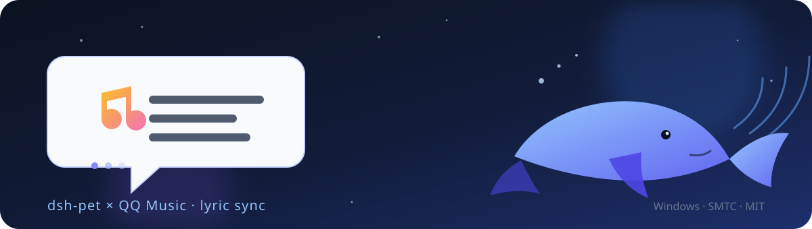

# 鲸歌 · dsh-pet-qqmusic

> 让 dsh-pet 跟着 QQ 音乐 / 网易云音乐，把歌词一句一句唱给你听。

一个 [DeepSeek Harness（DSH）](https://github.com/deepseek-ai/deepseek-harness) 插件：QQ 音乐走 Windows SMTC 读进度，网易云音乐读本地 `cloudmusic.elog`（不需要 BetterNCM / InfLink，支持 seek），按 LRC 时间戳把当前歌词送进 dsh-pet 的对话气泡。播到哪一句，桌宠就显示哪一句。

<p align="center">
  
</p>

<p align="center">
  
  
  
  
</p>

---

## 为什么叫「鲸歌」

dsh-pet 是一只住在 DSH 里的蓝鲸。鲸歌是鲸鱼在深海里传得很远的声音；这个插件做的事情很简单——把正在播放的歌，一句一句递到它嘴边。

项目名：**鲸歌**（Whale Song）  
包名 / 仓库名：`dsh-pet-qqmusic`（最初只支持 QQ 音乐，现在同时支持 QQ 音乐 / 网易云音乐）

---

## 效果

```text
QQ 音乐   晴天 — 周杰伦        00:29
桌宠气泡  ♪ 故事的小黄花

网易云    熄灭 — TC            01:09
桌宠气泡  ♪ 可不知不觉你的心已越来越远
```

歌词会随着播放进度逐行切换。默认带 600ms 提前量，用来抵消 dsh-pet 气泡约 1 秒的状态轮询；觉得快/慢可以直接调。

---

## 特性

- **双播放器**：QQ 音乐（SMTC）+ 网易云音乐（本地 elog），`player: auto` 自动跟随正在播放的那个
- **网易云无需插件**：直接解析 `cloudmusic.elog`，不需要 BetterNCM / InfLink；能感知播放/暂停和**拖拽 seek**
- **逐行同步**：按 LRC 时间戳切行，不靠猜
- **低延迟**：宿主 200ms 采样 + 客户端 300ms 轮询，并按 `nextLine.t` 主动排程下一行；默认 `offsetMs=600` 补偿 dsh-pet 的气泡轮询
- **版本匹配**：按「歌名 + 歌手 + 时长」在曲库挑版本，Live / 伴奏 / 翻唱降权；网易云优先用 songId 直接取词
- **跳过制作名单**：自动去掉开头的「词：/曲：/编曲：/吉他：」和「歌名 - 歌手」标题行
- **纯音乐识别**：返回「此歌曲为没有填词的纯音乐」时显示「纯音乐，请欣赏」，不乱唱
- **翻译可选**：有翻译时，可显示原文 + 译文两行
- **不刷新宠物模型**：web 桌宠用自绘歌词气泡；桌面悬浮模式用一键 quiet 补丁，歌词只更新气泡，不切动画、不重播
- **多桌宠**：`petId` 留空 = 当前桌宠，也可以固定投给某一只
- **零密钥**：不需要 DeepSeek / OpenAI / QQ 音乐 / 网易云的任何 API Key，也不读 Cookie

---

## 前置条件

| 条件 | 说明 |
|---|---|
| Windows 10 1809+ / Windows 11 | QQ 音乐依赖 Windows SMTC；网易云走本地日志 |
| QQ 音乐 PC 客户端 | 建议 ≥ 21.10.2962（更早版本不上报播放进度）；本项目在 22.76 上验证 |
| 网易云音乐 PC 客户端 | 建议 3.0+（会写 `cloudmusic.elog`）；本项目在 3.1.39 上验证 |
| dsh-pet | 已安装并启用；用到它的 `/dsh-pet-7340/broadcast` 端点，建议 0.3.5+ |
| DSH | 桌面版（desktop profile）或 `dsh web` 均可 |

### 开启 QQ 音乐 SMTC

QQ 音乐默认不向系统暴露媒体会话。打开：

```text
QQ 音乐 → 主菜单（≡）→ 设置 → 常规设置 → 通知
        → 勾选「显示系统媒体传输控制（SMTC）」
```

不同小版本菜单文案可能略有差异，认准 **SMTC / 系统媒体传输控制**。开启后播放任意歌曲，系统的媒体控制中心应该能看到 QQ 音乐。

### 网易云音乐：不需要 SMTC

网易云 3.0+ 不会注册新版 SMTC 会话，但会把播放事件写进：

```text
%LOCALAPPDATA%\NetEase\CloudMusic\cloudmusic.elog
```

插件直接读这个日志：

- 不需要 BetterNCM / InfLink-rs，不需要注入 DLL
- 不需要登录 API，不读 Cookie
- 能拿到歌名 / 歌手 / 专辑 / songId / 播放进度 / 暂停状态 / seek 位置
- 只解析上述字段，日志里的 `musicurl`（带签名）不会被读取或上传

只要启动过网易云并播放过一首歌，日志就会存在。如果日志不存在，插件会在桌宠气泡提示。

---

## 安装

> 没有 git 环境？可以直接从 [Releases](https://github.com/344272586-sketch/dsh-pet-qqmusic/releases/latest) 下载源码包。

### 方式 A：DSH 桌面应用（desktop profile）

DSH 桌面版的 profile 由 Electron 应用独占管理，`dsh plugin --profile desktop ...` 会提示 *profile "desktop" is managed exclusively by the Electron application*，所以本地插件需要手动登记：

1. 把仓库放到一个固定目录，例如 `C:\Plugins\dsh-pet-qqmusic`（下文用 `<PLUGIN_DIR>` 代替）：

   ```powershell
   git clone https://github.com/344272586-sketch/dsh-pet-qqmusic.git C:\Plugins\dsh-pet-qqmusic
   ```
2. 编辑 `%USERPROFILE%\.dsh\profiles\desktop\package.json`：

   - `dependencies` 加一行（JSON 里反斜杠要写成 `\\`）：

     ```json
     "dsh-pet-qqmusic": "link:<PLUGIN_DIR>"
     ```

   - `dsh.profile.bundles` 加一项 `"dsh-pet-qqmusic"`；

3. 在 profile 目录用 DSH 自带的 Node / pnpm 安装：

   ```powershell
   $profile = "$env:USERPROFILE\.dsh\profiles\desktop"
   $node = "$env:USERPROFILE\.dsh\dsh-runtimes\dsh-primary-runtime\dependencies\node\bin\node.exe"
   $pnpm = "$env:USERPROFILE\.dsh\dsh-runtimes\dsh-primary-runtime\dependencies\pnpm\bin\pnpm.mjs"
   & $node $pnpm install --dir $profile --config.confirmModulesPurge=false
   ```

4. **桌面悬浮模式额外打一次 quiet 补丁**（`display: "desktop"` 时必需；web 模式可跳过）：

   ```powershell
   cd <PLUGIN_DIR>
   & "$env:USERPROFILE\.dsh\dsh-runtimes\dsh-primary-runtime\dependencies\node\bin\node.exe" `
     scripts\patch-dsh-pet-quiet-lyrics.mjs --restart
   ```

5. 刷新 DSH 页面；如果没加载，完全退出 DSH 再打开一次。

### 方式 B：dsh web（web profile）

```powershell
dsh plugin --profile web add link:<PLUGIN_DIR>
# 发布到 npm 后也可以：
# dsh plugin --profile web add dsh-pet-qqmusic
```

装完重启 `dsh web`，刷新浏览器。

---

## 配置

用户配置在 `$DSH_HOME/dsh-pet-qqmusic/config.json`（默认 `%USERPROFILE%\.dsh\dsh-pet-qqmusic\config.json`）。改完下一轮生效，不需要重启。

| 键 | 默认 | 说明 |
|---|---|---|
| `enabled` | `true` | 总开关；关掉后浏览器侧不再投喂 |
| `petId` | `""` | 目标桌宠 id；空 = dsh-pet 当前桌宠（`/pet` 选中的那只，未选则第一只） |
| `player` | `"auto"` | `auto`：谁在播放就用谁；`qq` / `netease` 强制指定播放器（两个客户端同时开时有用） |
| `neteasePath` | `""` | 自定义 `cloudmusic.elog` 路径；空 = `%USERPROFILE%\AppData\Local\NetEase\CloudMusic\cloudmusic.elog`（改完需重启插件） |
| `displayMode` | `"auto"` | `auto`：web 桌宠用自绘气泡、桌面悬浮回落到投喂；`overlay`：只用自绘气泡（不触发动画，桌面模式不显示）；`bubble`：始终走 `dsh-pet /broadcast` |
| `offsetMs` | `600` | 歌词提前量（毫秒），范围 −5000 ~ 5000；正数 = 歌词更早出现。默认 600 是补偿 dsh-pet 气泡约 1 秒的轮询 |
| `keepAliveSec` | `8` | 同一行超过 N 秒补发一次，防止气泡 10 秒自动收起；`0` = 不补发 |
| `showTrackInfo` | `true` | 切歌时先显示「歌名 - 歌手」 |
| `showTranslation` | `false` | 有翻译时显示两行（原文 + 译文） |
| `prefix` | `"♪ "` | 气泡前缀，最多 8 字符 |
| `hints` | `true` | 没有 SMTC / 没开 QQ 音乐时让桌宠提示（每 10 分钟最多一次） |
| `debug` | `false` | 宿主日志开关 |

也可以直接改接口（把 `<DSH_PORT>` 换成你的 DSH 端口）：

```powershell
# 读
Invoke-RestMethod http://127.0.0.1:<DSH_PORT>/dsh-pet-qqmusic/config.json

# 改（只传要改的字段）
Invoke-RestMethod http://127.0.0.1:<DSH_PORT>/dsh-pet-qqmusic/config.json -Method Put `
  -ContentType 'application/json' -Body '{"offsetMs":800,"showTranslation":true}'
```

### 延迟调法

- 歌词比声音**快**：把 `offsetMs` 调小（负值）
- 歌词比声音**慢**：调大（正值）
- 默认 600ms 是给 dsh-pet 气泡轮询的补偿；蓝牙耳机 / 外置声卡常见再 ±200~500ms

---

## 工作原理

```text
QQ 音乐 PC ──SMTC──> smtc-helper.cs（C# / WinRT，首次启动编译）
                          │  title / artist / album / status / position / duration
                          │
网易云 PC ──cloudmusic.elog──> lib/netease-elog.js（逐字节解码 + 状态机）
                          │  songId / title / artist / album / position / seek / 播放状态
                          ▼
                    dsh-pet-qqmusic 宿主（Node）
                          │  1. player=auto：选正在播放的那个
                          │  2. QQ：QQ 曲库搜索 + GetPlayLyricInfo
                          │     网易云：songId 直接取词（本地缓存 / 公开 API）
                          │  3. 解析时间戳 / 合并翻译 / 纯音乐识别 / 磁盘缓存
                          ▼
              GET /dsh-pet-qqmusic/state.json（当前行 + 下一行 + 进度）
                          │
                          ▼
             浏览器侧 lib/client.js（300ms 轮询 + nextLine 主动排程）
                          │  行变化才发，keepAlive 到点补发
              ┌───────────┴────────────┐
              ▼                        ▼
   web 桌宠：自绘歌词气泡      desktop：POST /dsh-pet-7340/broadcast
   （复用 dsh-pet bubble CSS，  （文本前带 U+200B；打过 quiet 补丁的
     只改文本，不碰动画）         helper 只更新气泡、不切动画）
```

### 为什么桌面模式要打补丁

dsh-pet 的 `/broadcast` 在桌面 helper 里最终走 `PetSprite.showWhisper()`：它会随机挑一个碎碎念动画并 `playOnce()`。如果每句歌词都直接投喂，宠物模型就会每句换一次动作，看起来像在刷新。

补丁只给 `runtime/electron-helper/events.js` 的 `showWhisper` 加一个分支：带 `U+200B` 标记的投喂只更新气泡，不切动画、不 `playOnce`、不打断移动。普通碎碎念仍走原逻辑。

- **web 桌宠**：不需要补丁，客户端直接画歌词气泡（复用 dsh-pet 的 `.dsh-pet-bubble` 样式）
- **桌面悬浮小窗**：需要补丁，因为独立 Electron 窗口没有页面 DOM 可叠
- dsh-pet 升级覆盖 `events.js` 后，重跑一次 `scripts/patch-dsh-pet-quiet-lyrics.mjs --restart`

---

## 调试

| 路由 | 用途 |
|---|---|
| `GET /dsh-pet-qqmusic/` | 可视化调试面板（1.5 秒自动刷新） |
| `GET /dsh-pet-qqmusic/state.json` | 当前完整状态 |
| `GET /dsh-pet-qqmusic/health` | helper / 歌词状态 |
| `GET/PUT /dsh-pet-qqmusic/config.json` | 读 / 改配置 |
| `POST /dsh-pet-qqmusic/refresh` | 强制重新取词（绕过磁盘缓存） |

没有 SMTC 会话时：

```json
{
  "ok": true,
  "available": false,
  "qqmusicRunning": true,
  "hint": {
    "code": "smtc-off",
    "text": "QQ音乐没开 SMTC：设置 → 常规设置 → 通知 → 显示系统媒体传输控制（SMTC）"
  }
}
```

### 自检 SMTC

```powershell
& "$env:USERPROFILE\.dsh\dsh-pet-qqmusic\bin\smtc-helper.exe" --any
```

`count > 0` 且 `session` 非空，说明系统 SMTC 正常；再看 `source` 是不是 QQMusic。首次启动会自动从 `lib/smtc-helper.cs` 编译到这个路径。

---

## 常见问题

**桌宠只显示「QQ音乐没开 SMTC…」**  
按上面的路径开启 SMTC；开启后不用重启 DSH，插件下一轮会自己读到。网易云不走 SMTC，看到「网易云还没在播放」时直接播放即可。

**网易云没有反应 / 没有歌词**  
先看调试面板的 `health.netease` 与 `state.neteaseReason`：

- `elog-missing`：没有找到 `%LOCALAPPDATA%\NetEase\CloudMusic\cloudmusic.elog`。确认是网易云 3.0+，启动并播放过一首歌；日志会在播放时创建。
- `no-session`：日志存在但还没有播放事件，播放一首歌即可。
- `lyrics.error`：看是不是冷门歌/纯音乐/版权受限；切歌后会重新取词。

**网易云进度准吗 / 拖拽进度条会跳吗**  
会。插件解析的是 `cloudmusic.elog` 里的 `setPlayingPosition` 事件，拖拽 seek 后会立即更新位置，不是按启动时间硬估。

**QQ 音乐明明在播，有时不显示歌词**  
按顺序看 `state.json`：

1. `player` 是不是变成了 `netease`：网易云也开着时，旧版 SMTC helper 可能拿到网易云那个没有进度的会话。1.3.2 起会按「正在播放 > 有时间轴 > 最近更新」给会话打分，QQ 在播时优先 QQ；仍想强制就设 `player: "qq"`。
2. `playing` 是不是 `false`：QQ 音乐暂停 / 刚启动 / 还没真正出声时，SMTC 可能是 `Opened` 或 `Paused`，按一下播放键变成 `Playing` 才会有歌词。
3. `line` 是不是 `null` 而 `lyrics.status` 是 `ready`：通常只是还没到第一句（前奏、制作名单），气泡会显示歌名（`showTrackInfo` 默认开）。
4. `lyrics.status` 是 `error` 就看 `lyrics.error`；`hint.code` 是 `smtc-off` 就去开 QQ 音乐的 SMTC。

**QQ 音乐和网易云同时开着，投谁**  
默认 `player: "auto"` 选正在播放的那个；两个都在播时优先时间轴有效、最近更新的，平手偏 QQ。也可以强制：

```json
{ "player": "netease" }
```

**网易云需要 BetterNCM / InfLink 吗**  
不需要。本插件直接读本地 elog。只有网易云 2.x / 日志被关闭等极少数情况才需要 InfLink 把状态发布到 SMTC（本插件的 SMTC helper 也能识别 `cloudmusic` / `netease` 会话）。

**`available` 是 true，但一直没有歌词**  
看调试面板的 `lyrics.status` / `lyrics.error`。冷门歌、纯音乐、电台可能取不到词；插件会回落到 lrclib，仍失败就显示 `error`。点「重新取词」或 `POST /refresh`。

**歌词比声音快 / 慢**  
调 `offsetMs`：快就调小（负），慢就调大（正）。默认 600ms 已经补偿了 dsh-pet 的 1 秒轮询。

**每次新歌词出来，宠物模型刷新 / 换动作**  
说明还在走原生 `/broadcast` 且没打 quiet 补丁。桌面悬浮模式跑一次：

```powershell
node scripts/patch-dsh-pet-quiet-lyrics.mjs --restart
```

web 模式默认用自绘气泡，不会出现这个问题。

**dsh-pet 更新后又不安静了**  
更新会覆盖 `events.js`，重跑上面的补丁脚本即可。想彻底回到原生行为，把同目录的 `events.js.bak-qqmusic` 还原。

**杀软把编译出的 SMTC helper 删了 / 拦了**  
`/health` 会显示 helper 缺失或启动失败。删掉 `$DSH_HOME/dsh-pet-qqmusic/bin/smtc-helper.exe` 后重启插件，会从 `lib/smtc-helper.cs` 自动重新编译；也可以把该目录加白名单。helper 只读系统媒体会话，不发网络请求。

**桌面模式的宠物能看到吗**  
能。浏览器侧把歌词写进 dsh-pet 的 `pets.<id>.say`，桌面宠物与浏览器宠物读同一份状态。前提是 DSH 页面还开着。

**多只桌宠投给谁**  
`petId` 填 dsh-pet 的实例 id；留空 = `/pet` 选中的那只，未选则列表第一只。web 自绘气泡目前取第一只 `.dsh-pet-stage`，多宠物建议用 `bubble` 模式配合 `petId`。

---

## 隐私与安全

- **不需要任何 API Key**：不碰 DeepSeek / OpenAI / QQ 音乐 / 网易云账号凭据
- **不读 Cookie**：歌词走公开 Web 接口，只带歌名 + 歌手（网易云优先用 songId）
- **网易云日志只读**：只解析歌名 / 歌手 / 专辑 / songId / 进度；日志里的 `musicurl`（带签名）不进入状态、不落盘、不上传
- **不上传听歌记录**：SMTC / elog 元数据只在本机内存里流转
- **出站请求**：QQ 音乐公开曲库（搜索 / 歌词）、网易云公开曲库（songId 歌词 / 搜索），失败时可选回落 lrclib
- **helper 源码随包**：`lib/smtc-helper.cs` 可自行编译核对
- **补丁有备份**：`events.js.bak-qqmusic`，随时可还原

详见 [SECURITY.md](SECURITY.md) 与 [PERMISSIONS.md](PERMISSIONS.md)（文件 / 网络 / 命令 / 凭据 / 失败边界）。DSH STORE 的固定源码扫描与人工复核材料见 [STORE_REVIEW.md](STORE_REVIEW.md)。

---

## 兼容性与已知限制

- Windows 10 1809+ / 11；不支持 macOS / Linux
- QQ 音乐 PC 客户端版本过低时不上报进度；搜索 / 歌词接口不是腾讯官方开放 API，可能随客户端改版失效
- 网易云 3.0+ 的 `cloudmusic.elog` 格式是社区逆向出来的；客户端大版本更新可能改变字段或编码，届时需要跟进
- 网易云 2.x 不写这份日志，只能走 InfLink → SMTC 的路线
- 纯音乐、电台、试听片段可能没有可用歌词
- 桌面 quiet 补丁修改的是 dsh-pet 运行时文件，dsh-pet 升级后需重跑
- 歌词版权归原权利人所有；本项目只做本机展示，不提供下载 / 分发

---

## 开发

```powershell
# 单测（纯逻辑 + 客户端投喂节奏，不依赖 Windows）
node --test test/*.test.mjs

# 手动重建 SMTC helper（插件首次启动会自动编译，通常不需要）
C:\Windows\Microsoft.NET\Framework64\v4.0.30319\csc.exe /nologo /target:exe `
  /out:"$env:USERPROFILE\.dsh\dsh-pet-qqmusic\bin\smtc-helper.exe" `
  /r:C:\Windows\Microsoft.NET\Framework64\v4.0.30319\System.Runtime.dll `
  /r:C:\Windows\Microsoft.NET\Framework64\v4.0.30319\System.Runtime.WindowsRuntime.dll `
  /r:C:\Windows\System32\WinMetadata\Windows.Foundation.winmd `
  /r:C:\Windows\System32\WinMetadata\Windows.Media.winmd `
  /r:C:\Windows\System32\WinMetadata\Windows.Storage.winmd `
  lib\smtc-helper.cs
```

目录：

```text
dsh-pet-qqmusic/
├─ package.json
├─ cordis.patch.yml
├─ lib/
│  ├─ index.js          # 宿主：双播放器选择 / 路由 / 状态机 / 配置 / 缓存
│  ├─ lyrics.js         # LRC 解析 / 版本打分 / QQ + 网易云搜索与取词
│  ├─ netease-elog.js   # 网易云 cloudmusic.elog 解码 + 播放状态机
│  ├─ smtc.js           # Node 侧：按需编译 / 看护 helper、解析 JSON、进度外推
│  ├─ smtc-helper.cs    # C# 源码（首次启动编译到 $DSH_HOME/dsh-pet-qqmusic/bin）
│  └─ (bin/smtc-helper.exe 运行时生成，不随包分发)
├─ scripts/
│  └─ patch-dsh-pet-quiet-lyrics.mjs
├─ assets/banner.svg
├─ PERMISSIONS.md        # 文件 / 网络 / 命令 / 凭据 / 失败边界
└─ test/                # node:test
```

---

## 致谢

- [dsh-pet](https://github.com/PC2005-cloud/dsh-pet)：桌宠本体、公开的 `/broadcast` 投喂端点与气泡样式
- [DeepSeek Harness](https://github.com/deepseek-ai/deepseek-harness)：插件与 Web UI 运行环境
- [Lyricify 文档](https://docs.lyricify.app/)：QQ 音乐 SMTC 开启路径的参考
- [netease-cloudmusic-detector](https://github.com/YouRanCoder/netease-cloudmusic-detector-py)：`cloudmusic.elog` 解码表与状态机（MIT），本项目移植为 Node 版

QQ 音乐、腾讯及其素材归腾讯音乐娱乐集团所有；网易云音乐、网易及其素材归网易公司所有；dsh-pet 的角色素材归其作者所有。本项目与三者均无官方关联，不包含它们的代码或美术资源。第三方许可摘要见 [THIRD_PARTY_NOTICES.md](THIRD_PARTY_NOTICES.md)。

---

## License

[MIT](LICENSE)

变更记录见 [CHANGELOG.md](CHANGELOG.md)。
